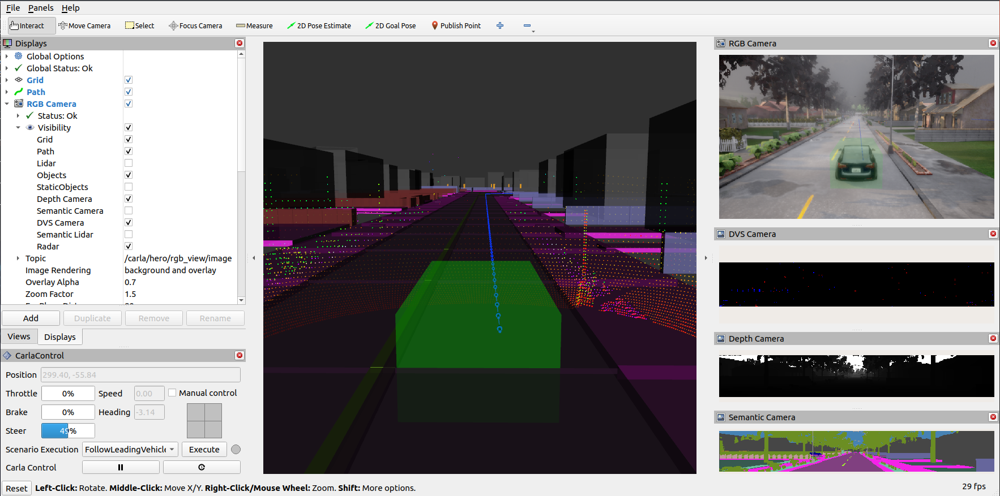

# carla-ros-bridge

  
  
  
   
  
  
  
  
  

**Bidirectional communication bridge between CARLA simulation and ROS ecosystems**

> [!IMPORTANT]
> This repository is a fork of the official CARLA [ros-bridge](https://github.com/carla-simulator/ros-bridge). All initial and following modifications to the original repository are documented in [CHANGELOG_OPENADS.md](./CHANGELOG_OPENADS.md).

> [!IMPORTANT]
> This repository is part of [***OpenADS***](https://github.com/openads-project), the *Open Automated Driving Systems* project. *OpenADS* and its modules have been initiated and are currently being maintained by the [**Institute for Automotive Engineering (ika) at RWTH Aachen University**](https://www.ika.rwth-aachen.de/de/).

> [!TIP]
> We recommend to use the *carla-ros-bridge* as **communication actor** in our open, modular and scalable simulation framework <a href="https://github.com/openads-project/openadsim">**OpenADSim**.

---
---
## Original README

 This ROS package is a bridge that enables two-way communication between ROS and CARLA. The information from the CARLA server is translated to ROS topics. In the same way, the messages sent between nodes in ROS get translated to commands to be applied in CARLA.

**This version requires CARLA 0.9.16**

## Features

- Provide Sensor Data (Lidar, Semantic lidar, Cameras (depth, segmentation, rgb, dvs), GNSS, Radar, IMU)
- Provide Object Data (Transforms (via [tf](http://wiki.ros.org/tf)), Traffic light status, Visualization markers, Collision, Lane invasion)
- Control AD Agents (Steer/Throttle/Brake)
- Control CARLA (Play/pause simulation, Set simulation parameters)

## Getting started and documentation

Installation instructions and further documentation of the ROS bridge and additional packages are found [__here__](https://carla.readthedocs.io/projects/ros-bridge/en/latest/).
